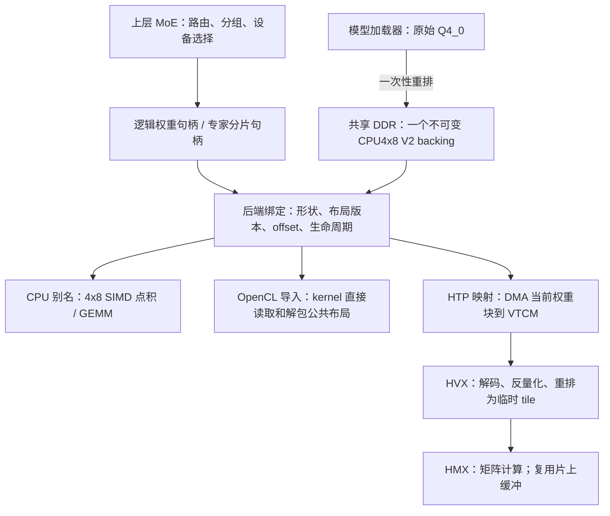

# 共享权重表示：解耦异构推理中的权重驻留与计算格式

**用途：** OSDI 论文的一个 Design 组成部分；中文设计说明、英文段落草稿及实验论证清单。

**实现与证据版本：** `feat/shared-weight-layout`；二维算子阶段截至 `425ee44fd`，MoE 接入 `b3e9e0f34`，完整模型对照 `fdb116ba2`。整理日期：2026-10-21。

**核心主张：** 在支持共享物理内存的异构 SoC 上，将不可变权重的长期驻留表示与各处理器的内部计算格式解耦。CPU、GPU 和 HTP 共享一个压缩权重分配；后端通过布局感知的读取内核，或容量受限的片上分块适配，消费同一表示。路由和设备选择属于上层。

这里的“共享”指不为每个后端维护完整、长期驻留的权重副本，不意味着没有 DMA、解包、反量化、临时激活或片上计算 tile。本文档中的实验数字均来自已有设备测量；待验证的能力与实验单独列明。

## 1. 系统问题与设计动机

异构推理不仅需要决定由哪个处理器执行算子，还需要保证该处理器能读取相应的权重。现有后端通常将同一逻辑矩阵重排为适合自身内核的物理格式：CPU 面向 SIMD 点积，GPU 面向线程协同访问，NPU 面向片上矩阵 tile。这使设备可执行性与权重驻留格式相互耦合。

当同一权重可能在不同处理器上执行时，系统通常面临三种选择：提前为多个后端保存副本；在切换设备时转换或复制；限制设备选择以适应已准备的布局。前两种分别增加常驻内存或切换开销，第三种限制调度自由度。共享 DDR 本身不能解决格式差异：即使两个处理器可以访问同一物理页，既有内核也未必能解释相同的字节排列。

另一方面，计算单元的内部格式不必等于完整模型的长期存储格式。量化矩阵乘本来就需要在寄存器或片上工作区中解包、反量化及形成计算 tile。本设计将必要的格式适配放到这一消费边界，保留一份公共压缩权重，并通过后端适配器连接具体内核。

**拟论证的系统价值是降低“让某权重可在另一处理器执行”所需的持久状态和准备工作。** 是否能进一步改善动态调度、切换延迟或可容纳模型规模，仍需专门实验。不能用已有固定放置的 MoE 实验替代这些验证。

## 2. 目标、边界与术语

| 项目 | 设计目标 / 当前范围 |
|---|---|
| 长期权重存储 | 同一已创建权重对象只有一个公共压缩 backing；后端绑定不生成完整专用副本 |
| 算子性能 | 已测配置中，相对每端最佳有效原生基线，算子耗时退化不超过 5%；这是经验目标，不是任意形状的保证 |
| 主机辅助 | 不在每次计算前由 CPU 转换完整权重；模型加载期允许一次转换 |
| 临时空间 | 允许容量受限的片上权重暂存及必要激活工作区，必须与持久权重分别计账 |
| 上层接口 | 上层持有逻辑权重句柄并选择设备；布局、导入和读取方式由中间层与后端处理 |
| 当前硬件 | Redmi K80 Pro 的 ARM CPU、Adreno 830 OpenCL、Qualcomm HTP/Hexagon；GPU 实现限制为 Adreno A8X |
| 当前矩阵 | 连续二维 Q4_0 权重 × F32 输入；三端共同要求 K 为 128 的倍数、M 为 32 的倍数 |
| 当前 MoE 接入 | 上层将专家 bank 切分为受控二维句柄，并将真实路由分组成二维计算图；不是直接支持公共布局的 3D `MUL_MAT_ID` |

本文使用以下区分：

- **逻辑权重**：矩阵的数值、形状和身份，不依赖执行设备。
- **驻留布局**：完整权重在共享 DDR 中长期保存的字节排列。
- **计算格式**：某次 kernel 所需的寄存器、local memory 或片上 tile 表示，可短期存在并复用。
- **绑定**：为一个权重句柄建立后端 tensor 与内存映射，未复制完整权重 payload。

“透明”仅指在支持契约内，上层无需维护各端的权重排列和转换流程。当前实现需要显式接入句柄、构图并检查算子支持；它不是对所有既有模型、算子和任意 tensor view 的自动替换层。

## 3. 关键设计：公共驻留表示与后端消费适配

### 3.1 架构



图中三端绑定描述的是能力和接口，不表示一次推理必须把同一专家同时分配到三端。固定放置可以只绑定对应设备；多设备绑定与并发只读消费由底层契约支持。

### 3.2 一个 backing，多个受控绑定

权重对象包含共享内存描述符、布局版本、矩阵维度和字节偏移，并缓存已建立的后端绑定。当前共享内存由 HTP allocator 分配，CPU 获得主机映射，OpenCL 导入同一 DMA-BUF/ION 存储，HTP 通过 RPC 映射访问。各端可使用不同的地址空间与句柄；相同逻辑权重指向同一底层 backing。

这个接口的必要组成部分是 **共享分配 + 元数据契约 + 后端读取实现**。只增加一个 tensor ID，或只把地址传给原有 kernel，都不足以解决布局差异。

单份 backing 是同一对象及其分片的所有权保证。当前 API 不提供按权重内容哈希的全局去重：调用方若重复创建两个完整对象，仍会分配两份存储。MoE 集成通过每个 bank 只创建一次来维持单份存储。

### 3.3 为什么采用 CPU4x8 V2

当前公共布局取自 ARM CPU 的高效 Q4_0 4x8 排列。选择它的工程依据是：CPU 可以复用已有高效点积实现；GPU 能以可编程 kernel 解释该排列；HTP 能利用向量单元及片上工作区完成局部适配。因此可以把格式适配分配给具备相应能力的消费路径，同时减少 CPU 端运行时转换。

这不是对所有处理器组合的最优布局证明，也未实现自动布局搜索。论文中应把“公共表示如何选择”与“当前选择的经验效果”分开。

设权重 W 的逻辑形状为 M×K。一个公共块包含四个输出行、每行 32 个权重：

- 4×32 个 Q4 值，占 64 字节；
- 每行一个 FP16 scale，共 8 字节；
- 总计 72 字节，按 8 字节交错，并使用可逆的 XOR 编码。

块的索引为 `[M/4][K/32]`，总 payload 为：

```text
S(W) = (M/4) × (K/32) × 72 = 9MK/16 bytes
```

因此，在已支持的维度上，公共表示保留 Q4_0 原有压缩大小。加载重排只改变排列和可逆编码，不重新选择量化值或 scale。逐字节恢复 canonical Q4_0 的测试验证了这项性质；它不意味着所有后端的浮点输出都相同。

## 4. 三端如何消费同一表示

### 4.1 CPU：直接复用匹配布局的内核

CPU 绑定为共享 backing 建立只读 tensor 别名，选择已有 Q4_0 4x8 trait。输入激活按对应算子的需求临时量化；多 token 时使用批量矩阵乘，尾部或小批量使用矩阵向量乘。公共权重无需在每次计算前重排为另一份 CPU 权重。

“CPU4x8”描述排列方式，不描述内存归属，也不要求其他处理器将计算交给 CPU。

### 4.2 GPUOpenCL：在 kernel 中解释公共布局

GPU 先将共享分配导入 OpenCL buffer，再由布局感知的 kernel 根据输出行、K block 和专家 offset 定位数值与 scale。kernel 解开 4-bit 数值并执行乘加，不调用会生成完整后端专用权重的传统上传/重排路径。

当前较大批量路径在支持整数点积且 N>8 时使用 DP4A：激活暂时量化为 Q8_1，公共 Q4 权重在 kernel 内读取、解包并参与整数点积。其他批量使用对应浮点路径；部分路径包含 F32→F16 激活转换。所谓“直接消费公共布局”并不意味着没有解包、寄存器表示变化或激活工作区。

需要区分两项独立决策：权重采用什么驻留布局，以及计算采用什么激活精度/内核。论文比较必须控制后者，避免把 DP4A 的收益算作公共布局的收益。

### 4.3 HTP：在消费时形成有界的片上计算 tile

当前 HTP 路径使用 Hexagon 的 HVX 向量单元与 HMX 矩阵单元。HMX 对内部 tile 有固定要求，不能直接将 DDR 中的 CPU4x8 字节解释成其矩阵输入。

执行时，DMA 将一个压缩权重块带入 VTCM；HVX 对该块解包、反量化并重排为 HMX 使用的 FP16 tile；HMX 随后执行矩阵乘。处理完的工作区由后续块复用，不在 DDR 中缓存完整的 HTP 专用权重。小批量也可采用直接解码的 HVX 点积路径。

为限制格式适配的成本，实现先在 4-bit 压缩域进行必要转置，再展开数值；使用向量查表及连续 K-block 地址遍历；在容量允许时对权重搬运、解码和矩阵计算进行流水化。工作区受当前设备 8 MiB VTCM 预算约束，包含压缩暂存、展开 tile 及其他算子工作区，不表示可为每项分别使用 8 MiB。

原生 Q4_0 HTP 路径也存在量化权重解码，因此应比较两种布局各自的实际消费成本，不能将公共布局全部解码时间视为新增开销。流水线可以隐藏部分适配时间，但首尾阶段、带宽竞争和解码速度不足仍会暴露开销。

## 5. 接口、所有权与安全边界

核心接口可概括为：

```text
create_with_layout(allocator, K, M, canonical, layout) -> weight
slice_rows(weight, first_row, rows)                   -> retained_weight
bind(weight, backend)                               -> backend_tensor
describe(weight)                                    -> borrowed_descriptor
free(weight)
```

生命周期如下：

1. 加载器创建 backing 并完成一次性转换，然后可释放其 canonical 临时输入。
2. 上层通过 `bind` 创建并缓存所需设备的 tensor；检查算子和形状支持。
3. 计算阶段只读访问权重；不同后端可在绑定完成后重叠执行。
4. 释放句柄时同步相关执行，并按生命周期释放导入和存储。

设计维持以下不变量：

- **不可变 payload。** 创建完成后不允许常规 tensor set/clear/copy 修改共享权重；测试中的 scale 翻转仅用于同步后的 alias 验证。
- **显式布局。** 描述符携带布局版本及形状，后端不能将公共字节误认成自己的原生格式。
- **受控别名。** 专家切分通过 retained slice API 完成，行边界为 32 的倍数、字节 offset 为 128 对齐，并检查存储范围；任意 view 不自动合法。
- **存储生命周期。** 分片持有 backing 的引用，父句柄释放后仍可保留；所有相关 backend 必须保持有效。`describe` 的结果只是借用，不能超出句柄生命周期。
- **能力检查。** 创建和绑定阶段检查对应的维度、布局及后端导入能力；算子支持必须由调用方通过 `ggml_backend_supports_op` 另行检查。失败时上层应显式选择原生路径，不能静默建立隐藏完整副本再声称共享成功。
- **同步契约。** bind/free 需要外部串行化；提交与完成沿用后端及平台的一致性机制。共享 fd 并不等价于任意主机写入都无需同步。

当前是不可变推理权重接口，没有在线权重更新、多版本训练或跨进程分布式一致性协议。

## 6. MoE 位于中间层之上

中间层不知道 expert ID、top-k、路由概率、预测策略或设备负载。MoE 层负责将这些语义映射到权重句柄和执行图。

当前每层分别为 gate/up/down 创建包含 60 个专家的 bank，再通过连续行分片引用各专家。分片是受控的二维 tensor，不复制专家权重。shared expert 的三个 Q4_0 投影也采用相同方式；其小型 F16 gate 保留一份公共 F16 存储。

运行时，上层依据当前真实 router 输出将 token 按专家分组，为每个后端提交包含本端活跃专家的二维计算图。三个后端并发，主机按原 top-k 顺序合并输出。grouped 2D graph 是当前集成方式，属于 MoE 执行策略，不应写成公共权重层的必要接口语义。

预绑定多个后端使“切换执行端时无需转换完整权重”成为可能，但仍会有调度、激活准备、冷 cache 和同步开销；首次绑定也可能有驱动映射与 kernel 初始化成本。现有固定 `c8-g15` 实验没有证明任意专家的在线迁移收益或首次切换延迟。

## 7. 成本模型与可检验假设

对于一个逻辑权重对象，令公共压缩大小为 S，后端绑定元数据为 H_b，运行时临时工作区为 A_b。公共表示的持久状态可写为：

```text
M_persistent = S + Σ H_b
```

若一个对照为了多端可执行性提前保存完整后端布局，则其权重部分为 `Σ S_b`；若对照只将每个专家放在一个后端，其权重部分本来就约为 S。本设计的权重节省取决于基线的复制策略，不能固定宣称减少到三分之一。

总运行内存还必须考虑 activation arena、kernel scratch、片上空间、KV、其他模型权重、驱动元数据、源文件映射与页缓存。物理页别名必须去重，不宜直接将所有进程 RSS、DMA 分配和映射长度相加。

对于支持的后端 b 和形状，定义：

```text
R_b = T_common,b / T_best-native,b
```

目标是 `R_b ≤ 1.05`。`T_common,b` 必须包含该算子所需的激活准备、搬运及布局解码；不能只计矩阵计算指令。对可重叠的阶段，应测真实关键路径，不把 DMA、解码、计算时间简单相加。

关于 HTP，合理的设计假设是：当分块适当且解码吞吐足够时，流水化可以使稳态速度接近搬运、解码、矩阵计算中最慢的一项。该假设需要 trace 验证；当前没有对每个形状分别量化隐藏了多少解码成本。

## 8. 已有证据及其支持范围

### 8.1 二维算子：公共布局的适配代价

设备为 K80 Pro，权重来自指定 Qwen Q4_0 模型。测试 K/M=2048/1408 与 1408/2048，N=1/32/128，三端共 18 组。每组八次预热后交替执行，CPU/GPU 各 512 次，HTP 128 次。

| 后端 | 最差公共/原生时延比 | 各组 95% 区间上界的最大值 | 计时口径 |
|---|---:|---:|---|
| CPU | 1.03787 | 1.04845 | 单算子图及完成，包含运行时准备；4 线程、固定 mask f0、持久线程池 |
| OpenCL | 1.02064 | 1.02374 | 全部 kernel event 之和，含激活量化；原生基线启用 DP4A |
| HTP | 1.03509 | 1.04425 | DSP op 时间，含 DMA/解码，不用 host/RPC 时间稀释差异 |

区间来自每组配对分块 bootstrap：2000 次重采样、连续 8 样本的圆形块。它们是各测试条件内的区间，不是对任意形状或所有条件联合成立的统计保证。原生基线为本轮可用且有效的已测实现中的最佳者，不代表所有潜在内核的全局最优。

支持的结论：在上述具体设备与二维工作负载中，公共表示的算子耗时退化满足 5% 目标。不能外推到其他量化、其他 SoC、任意形状或完整 MoE 调度策略。[E1]

### 8.2 单份存储与分片正确性

对两个真实二维矩阵，每个 payload 与共享 allocation 均为 1,622,016 字节。完整、部分、尾部 canonical 回读逐字节一致。绑定完成后，在测试专用同步区间修改 backing 中的 scale 符号，三端计算结果随之改变，恢复后结果恢复，核验已绑定路径没有继续使用隐藏的旧完整权重副本。[E1]

MoE 接入又验证了非零偏移、不同相邻专家数据、非法分片拒绝和父对象先释放后的分片生命周期。三端各 20 个边界 case 通过。实际 layer0 FFN 使用专家 0/7/31/59、N=1/17/32 与各端旧路径对比：CPU/HTP NRMSE=0；GPU 最大整体 NRMSE 约 1.43%，通过既定 token 误差门限。[E2]

这些测试与实现审计共同支持当前受控路径的单份 payload 与数值正确性；不替代完整驱动物理内存计账或模型质量评估。

### 8.3 完整 MoE：集成效果，尚非布局因果消融

复用 Qwen1.5-MoE-A2.7B-Chat Q4_0、固定 `c8-g15` 三端放置、wetland/foundry 两个 frozen 输入、768-token 完整 prefill。真实路由，包含最后 token logits；加载、布局准备和 KV reset 在请求计时外。每条件两个进程，每进程 2 warmups +6 timed，以 native/shared/shared/native 顺序运行，主统计为两个进程 median 的平均。[E2][E3]

| 输入 | 原生布局 + 原 MMID 执行器 | 公共布局 + grouped 2D 执行器 | 时延变化 |
|---|---:|---:|---:|
| wetland | 1012.69 ms | 936.30 ms | -7.54% |
| foundry | 1045.98 ms | 921.59 ms | -11.89% |

这证明当前集成能执行完整模型，并在这两个实验条件下改善请求时延。它不能隔离布局收益，原因包括：

- 旧路径使用 `MUL_MAT_ID`，新路径使用按专家分组的二维矩阵乘；CPU 的批量计算方式、GPU 的路由处理及 HTP pipeline 选择都可不同。
- GPU 原 MMID 的默认策略与新公共路径的 DP4A 选择不同，激活计算精度也可能不同。
- 数值差异影响后续真实路由；固定 prompt 不等于完全相同的逐层后端工作量。
- CPU 辅助与后端内部 gather 的计时归属发生变化；完整请求时间仍包含 host 工作，但累计 backend 时间不能作为等价纯 GEMM 时间。

同条件跨进程 logits bitwise 一致；两输入新旧最后 token 相同，logits NRMSE 分别约 1.80%/1.42%。这不是 perplexity、长序列生成或任务准确率验收。

### 8.4 内存结果与未完成目标

| 专家执行相关分配 | 原路径 | 当前公共布局路径 |
|---|---:|---:|
| 有效权重 payload，含 shared expert 和 F16 gate | 7,474,348,032 B | 7,474,348,032 B |
| 权重 allocation | 7,474,383,360 B | 7,474,348,032 B |
| 三端 activation arena 合计 | 220,274,688 B | 380,657,664 B |

旧固定放置本来就没有为每个专家复制三份权重，因此权重容量基本不变。新路径共有 168 个物理 owner 和 4,392 个 retained slice handles；后者是元数据，不是 4,392 份 payload。当前激活区保守预留增加 **152.95 MiB**，尚未达到“几乎无额外运行内存”的目标。[E2]

原始 GGUF mmap 和文件页缓存仍可存在；当前单份存储主张限定于执行器维护的压缩权重 backing，不声称系统中不存在任何 canonical 文件页。现有 RSS/HWM 不足以给出完整 DMA/驱动/片上峰值内存。CPU 算子沿用 4 线程实验设置，也未验收“1–2 小核辅助即可”的最终约束。

## 9. 投稿前最关键的补充实验

### 9.1 隔离布局与执行策略

| 条件 | 权重布局 | 专家执行方式 | 用途 / 当前状态 |
|---|---|---|---|
| A | 各端原生 | 原 MMID | 已测固定放置基线；还应检查更优内核配置 |
| B | 各端原生 | 与 C 相同的 grouped 2D 图 | 关键缺口；A→B 衡量执行组织变化 |
| C | 公共布局 | grouped 2D 图 | 已测；B→C 才更接近布局适配代价 |

B/C 需匹配激活精度、点积策略、线程/核心、形状、临时空间预算及计时边界。对实际路由变化，建议另用相同捕获输入和路由做受控层级消融，并保留真实路由完整模型实验；二者回答不同问题。不能用 replay 路由的收益直接代替真实运行收益。

### 9.2 验证系统价值

| 优先级 | 实验 | 回答的问题 |
|---|---|---|
| P0 | 同一权重在预绑定 CPU/GPU/HTP 间按指定序列切换；分别记录首次与稳态延迟、转换字节数、CPU 开销 | 是否实际消除了跨端准备完整权重的需求，切换收益是多少？ |
| P0 | 对比固定单端放置、完整多端复制、按需转换/有界缓存与公共表示；匹配内存预算 | 公共表示在什么访问模式和预算下有价值？ |
| P0 | 对 backing/导入别名去重计账，报告 DMA、驱动、主机/设备 scratch、VTCM、KV、页缓存及峰值 | “单份权重”是否真的改善系统内存，而非转移到未计账区域？ |
| P0 | perplexity 或任务质量、较长 teacher-forced 序列、不同量化/激活策略的误差 | 新内核的数值变化是否在可接受范围？ |
| P1 | 对 HTP 去掉流水重叠、替换解码方案；测 DMA/HVX/HMX 分阶段 trace | 哪些机制把公共布局适配成本压到目标以内？ |
| P1 | 多个 token 数、长尾专家负载、decode、小矩阵、更多模型与设备 | 何时获益，何时因小批量或适配开销退化？ |
| P1 | 多独立进程、交替顺序、热状态/频率记录、能耗与 CPU affinity 控制 | 结果是否可重复，是否满足 CPU 预算与移动端能效要求？ |

新布局与此前 V1/原生表示的选择依据也应通过受控比较支撑。不要将“CPU4x8 是当前有效选择”写成“CPU 布局天然适合所有加速器”。

## 10. 论文中的定位与主张边界

适合作为系统设计点的表述是：**将逻辑权重身份、共享驻留表示与设备执行适配分层，使上层调度无需以完整后端权重副本作为设备可执行性的前提。** 其中，布局感知内核与片上适配提供可执行性，所有权和能力契约提供可组合的系统接口，实验负责证明性能与内存代价。

仅凭采用 DMA-BUF 或编写一个布局读取 kernel，尚不足以证明面向 OSDI 的贡献。更有说服力的证据是它如何改变整个异构推理系统在内存预算、设备选择和准备延迟之间的取舍。本设计作为论文的一个组成部分，应与上层调度机制及其受控评估衔接。

| 当前可以使用的表述 | 当前不应使用的表述 |
|---|---|
| 受控三端实现共享同一份压缩权重 backing | 任意 CPU/GPU/NPU 都能直接消费任意布局 |
| 必要格式适配在 kernel 或有界片上工作区中完成 | 零转换、零 DMA、零临时空间 |
| 已测二维算子在各条件下满足 5% 退化目标 | 任意模型/形状都达到各端最优性能 |
| 固定 MoE 对照中联合方案改善 prefill 时延 | 中间层单独使端到端加速 7.5%–11.9% |
| 取消完整后端权重副本的需求 | 本次实验减少三分之二模型内存 |
| 支持不可变权重的受控多端绑定 | 已实现任意专家在线迁移、统一全局去重或权重更新一致性 |

本材料未进行系统性的外部文献检索，不作“首次”或已有工作无法实现的主张。Related Work 应覆盖：共享内存/零复制互操作、统一内存与格式兼容的区别、量化内核布局、片上布局转换、异构推理放置以及多格式权重缓存。发表时需用核验后的外部引用替代内部实现链接。

## 11. 可改写进论文的英文 Design 草稿

### Shared Weight Representation

Heterogeneous inference couples execution placement with weight preparation. A processor can execute an operator only if the required weights are available in a representation supported by its kernels. Preparing separate representations can increase persistent memory consumption, while preparing them on demand adds conversion work to device transitions. Shared physical memory alone does not remove this constraint: kernels may interpret the same bytes differently.

We separate the persistent representation of an immutable weight tensor from the representation used inside a compute engine. Each supported Q4_0 weight bank owns one compressed allocation in shared DRAM; expert slices retain that allocation. Backend bindings associate this allocation with a layout version, tensor dimensions, and a byte offset. CPU, GPU, and HTP consumers access the same backing through their respective mappings. Layout-aware kernels interpret the shared representation directly, or materialize bounded tiles in on-chip memory. The runtime does not maintain a complete persistent weight replica for each backend. The small F16 gating weights in our MoE integration retain their existing uncompressed representation in separate shared allocations.

Our current implementation uses a Q4_0 representation organized around the CPU's four-row, eight-byte-interleaved layout. Each group of four rows and 32 columns occupies 72 bytes, including four FP16 scales. The representation preserves the original quantized values and their storage size. The CPU reuses its corresponding dot-product kernels. OpenCL kernels calculate addresses in this representation and unpack values as part of execution. The shared representation does not imply that all backends use identical arithmetic or activation precision.

The HTP adapter separates weight residency from the HMX engine's internal tile format. It transfers compressed chunks into VTCM, uses HVX to decode and arrange them into temporary FP16 tiles, and invokes HMX on those tiles. The workspace is reused across chunks and constrained by the device's VTCM budget. Where supported by the selected kernel and chunking configuration, pipelining overlaps preparation of subsequent chunks with matrix computation. This design avoids a full persistent HTP-specific weight image while retaining the engine's required internal format; it does not eliminate decoding or data movement.

The interface exposes immutable weight handles and controlled row slices. Slices retain the backing allocation and carry validated offsets rather than copying expert payloads. Creation and binding validate the applicable shape, layout, and import constraints; the caller separately checks operator support through the backend capability interface. Bindings are cached. The caller serializes binding and release operations and keeps the relevant backends alive. Immutability permits overlapping read-only execution after bindings have been established, subject to the platform's synchronization contract.

MoE routing remains above this abstraction. The MoE runtime maps experts to slices, selects execution backends, and constructs operator graphs. Our current integration groups routed tokens by expert and executes two-dimensional matrix multiplications. This execution strategy is separate from the shared-storage mechanism. We therefore evaluate representation overhead with matched operator baselines and report full-model results as the combined effect of representation and execution strategy.

**可放入 Evaluation、不可直接当作 Design 保证的结果句：**

> On the evaluated K80 Pro configurations, the worst median operator-time ratios relative to the best measured valid native baselines were 1.038, 1.021, and 1.035 for CPU, GPU, and HTP, respectively. In two fixed 768-token MoE prefill workloads, the integrated design reduced request latency by 7.5% and 11.9%; these results include changes to expert execution and do not isolate representation alone. Persistent expert-weight payload remained unchanged relative to the partitioned baseline, while the current integration reserved an additional 153 MiB for activation arenas.

## 12. 实现与证据索引

以下链接为仓库内部可追溯出处，不是论文 Related Work 引用。

| 标记 | 来源 | 用途 |
|---|---|---|
| E1 | [二维算子阶段验收](../../task/handoff/handoff-2026-10-16-shared-weight-layout/handoff-08.md)；[统计原始汇总](../../task/handoff/handoff-2026-10-16-shared-weight-layout/evidence/acceptance-final.json) | 性能门限、计时口径、布局大小、别名及数值验证 |
| E2 | [MoE 端到端报告](../../task/handoff/handoff-2026-10-21-shared-weight-moe-e2e/results.md) | 实验设置、内存代价、数值与因果边界 |
| E3 | [MoE 对比数据](../../task/handoff/handoff-2026-10-21-shared-weight-moe-e2e/comparison.json)；[归档清单](../../task/handoff/handoff-2026-10-21-shared-weight-moe-e2e/artifact-manifest.json) | 原始进程统计、二进制 hash、证据归档 |
| I1 | [接口](../../ggml/include/ggml-shared-weight.h)；[对象、转换与分片](../../ggml/src/ggml-shared-weight.cpp) | handle、owner、offset、retained lifetime |
| I2 | [CPU 绑定](../../ggml/src/ggml-cpu/shared-weight.cpp)；[CPU 4x8 计算](../../ggml/src/ggml-cpu/repack.cpp) | V2 直接选择原生 4x8 trait；不要把 V1 的 scratch 重排误写成 V2 路径 |
| I3 | [OpenCL 绑定与分派](../../ggml/src/ggml-opencl/ggml-opencl.cpp)；[共享 kernel](../../ggml/src/ggml-opencl/kernels/shared_q4_0.cl) | DMA 导入、布局感知读取与 DP4A |
| I4 | [HTP host 绑定](../../ggml/src/ggml-hexagon/ggml-hexagon.cpp)；[HTP 执行](../../ggml/src/ggml-hexagon/htp/matmul-ops.c)；[HMX 解码](../../ggml/src/ggml-hexagon/htp/hmx-mm-kernels-tiled.h)；[HVX 点积](../../ggml/src/ggml-hexagon/htp/hvx-mm-kernels-tiled.h) | offset、VTCM 分块、解码与计算 |
| I5 | [MoE 消费层](../../tests/moe-shared-weight.h)；[完整模型执行器](../../tests/fullmodel-oracle.cpp) | 专家分片、真实路由、分组执行与内存计账 |
| I6 | [算子验证](../../tests/shared-weight-probe.cpp)；[MoE 单层验证](../../tests/moe-shared-weight-probe.cpp)；[端到端 runner](../../tests/run-moe-shared-weight-e2e.py)；[数据分析](../../tests/analyze-moe-shared-weight-e2e.py) | 回归与复现入口 |

后续更新本文档时，应同时更新相应实现版本与证据范围。尤其不要在修改激活精度、调度方式、内存容量或基线选择后，继续复用旧测量支持新的性能主张。
