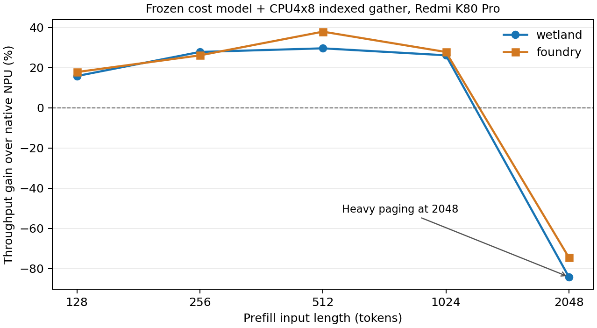

# 固定代价模型：128–2048 tokens 相对原生 NPU

设备fd8657d6 / Redmi K80 Pro；模型Qwen1.5-MoE-A2.7B Q4_0；执行代码基线5b32b8743。代价模型runtime-fast-cpu150保持冻结，异构启用单份CPU4x8权重和indexed DMA gather。

## 完整prefill性能

主统计先取每进程6样本的中位数，再平均同条件两个进程；吞吐提升=NPU耗时/异构耗时−1。所有240个计时样本保留。

| tokens | 输入 | NPU ms | 异构 ms | NPU token/s | 异构 token/s | 吞吐提升 | 总体中位数口径提升 |
|---:|---|---:|---:|---:|---:|---:|---:|
| 128 | wetland | 511.103 | 441.144 | 250.44 | 290.15 | +15.86% | +15.85% |
| 128 | foundry | 513.922 | 436.140 | 249.06 | 293.48 | +17.83% | +17.70% |
| 256 | wetland | 611.000 | 477.911 | 418.98 | 535.66 | +27.85% | +28.09% |
| 256 | foundry | 614.331 | 487.003 | 416.71 | 525.66 | +26.15% | +25.78% |
| 512 | wetland | 838.306 | 646.583 | 610.76 | 791.86 | +29.65% | +30.28% |
| 512 | foundry | 844.382 | 612.111 | 606.36 | 836.45 | +37.95% | +37.91% |
| 1024 | wetland | 1300.907 | 1030.970 | 787.14 | 993.24 | +26.18% | +25.32% |
| 1024 | foundry | 1304.251 | 1020.266 | 785.12 | 1003.66 | +27.83% | +28.88% |
| 2048 | wetland | 2507.417 | 15802.981 | 816.78 | 129.60 | -84.13% | -83.33% |
| 2048 | foundry | 2690.158 | 10532.316 | 761.29 | 194.45 | -74.46% | -70.99% |

## 数值与运行状态

同输入、同长度、同后端配置的两个进程最终logits逐位一致。跨NPU/异构存在布局、算子和精度路径差异，下面是最终logits的有限数值核验，不代表完整生成质量评估。

| tokens | 输入 | logits NRMSE | cosine | top1一致 | top10重合 | NPU major faults范围 | 异构 major faults范围 |
|---:|---|---:|---:|---|---:|---|---|
| 128 | wetland | 4.412% | 0.999026 | True | 10/10 | [0, 1] | [0, 3] |
| 128 | foundry | 3.465% | 0.999399 | True | 10/10 | [0, 1] | [0, 0] |
| 256 | wetland | 1.814% | 0.999835 | True | 10/10 | [0, 1] | [0, 0] |
| 256 | foundry | 6.339% | 0.997991 | True | 10/10 | [0, 1] | [0, 0] |
| 512 | wetland | 2.589% | 0.999670 | True | 10/10 | [0, 1] | [0, 0] |
| 512 | foundry | 2.591% | 0.999664 | True | 10/10 | [0, 1] | [0, 0] |
| 1024 | wetland | 2.726% | 0.999634 | True | 10/10 | [0, 1] | [0, 1769] |
| 1024 | foundry | 1.331% | 0.999911 | True | 10/10 | [0, 1] | [0, 41] |
| 2048 | wetland | 4.525% | 0.998994 | True | 9/10 | [0, 1] | [38456, 43793] |
| 2048 | foundry | 2.051% | 0.999790 | True | 9/10 | [0, 1] | [25136, 44958] |

**分页压力：**存在异构计时请求超过1000次major faults；对应结果全部保留。这些长度的实测包含操作系统分页代价，不能解读成低缺页常驻条件下的纯算力或调度效率。首个2048异构进程的只读内存快照在evidence/n2048-wetland-hetero-1-memory-observation.json；该进程运行中做过额外只读状态查询。

## 调度与内存

调度使用每层当前真实router IDs统计负载，进行整专家分配。没有重放预存route、重新拟合代价模型或按长度挑选策略。前23层routed专家三端均可用、shared固定NPU；最后层单token专家固定CPU。两输入使用相同availability。下表份额仅统计前23层routed token-expert pairs，不包括shared专家；CPU/NPU/GPU顺序固定。

| tokens | 输入 | Routed pair份额 CPU/NPU/GPU | 调度时间中位数 ms/请求 | activation arena MiB |
|---:|---|---|---:|---:|
| 128 | wetland | 25.40%/38.46%/36.14% | 1.273 | 63.006 |
| 128 | foundry | 24.37%/39.20%/36.43% | 1.245 | 63.006 |
| 256 | wetland | 16.58%/43.50%/39.92% | 0.629 | 123.012 |
| 256 | foundry | 16.34%/43.67%/40.00% | 1.432 | 123.012 |
| 512 | wetland | 12.27%/49.18%/38.56% | 1.906 | 243.023 |
| 512 | foundry | 12.35%/49.08%/38.57% | 0.715 | 243.023 |
| 1024 | wetland | 9.34%/55.47%/35.19% | 2.013 | 483.047 |
| 1024 | foundry | 9.31%/55.89%/34.80% | 1.261 | 483.047 |
| 2048 | wetland | 7.41%/60.62%/31.97% | 2.455 | 963.094 |
| 2048 | foundry | 7.39%/60.76%/31.86% | 2.558 | 963.094 |

所有异构进程唯一权重payload/allocation均为7,474,348,032 B。arena是预留激活容量，不是总进程RSS。较长输入会增加KV和activation容量；不能由权重共享推断总内存固定。

## 协议、边界与复现

- 五档长度各两个输入，每输入4进程：wetland NPU/hetero/hetero/NPU，foundry反向；每进程2warmup+6timed，间隔30秒。
- 两路径n_ctx=n_batch=n_ubatch=nt，单chunk，F16 KV、CPU outer4线程，异构expert4线程。前nt tokens逐项相同，跨长度严格前缀。
- 计时包含完整prefill、attention/KV/router/专家、同步及最后token logits；加载、布局准备和计时前KV清空排除。没有decode。
- 原生NPU为mode=npu，日志均核验25/25层offload到HTP0，保留框架CPU fallback。异构为mode=custom，共享权重、动态分配与输入融合。这是完整方案对比，不是只改变owner的因果消融。
- 全程固定并核验binary/library/代价模型/输入hashes；GGUF核验路径、大小、mtime，未对8GB模型重新计算全文件hash。设备boot ID逐进程核验；温度、缺页、全部样本在run.json和报告内。没有调频/affinity设置。
- 本实验考察同设备同模型下输入长度和两个文本的外推；不证明跨设备、跨模型或长时间热稳态泛化，也没有验证1–2小核约束。
- 复算：`python3 task/handoff/handoff-2026-10-22-length-sweep/analyze.py`，导出：同目录`render.py`。`run.py`拒绝覆盖已有cohort；重跑应使用新目录/tag。
- 原始结果、冻结binary/库/输入/代价模型及可用性计划归档见archive-record.json；CSV见comparison.csv，精确统计见summary.json。
- 用户提出的历史128约40%收益核对，以及扫描结束后独立执行的原始输入四路径对照，见[128收益差异分析](attribution128.md)。补充对照不混入上述冻结代价模型长度扫描。
